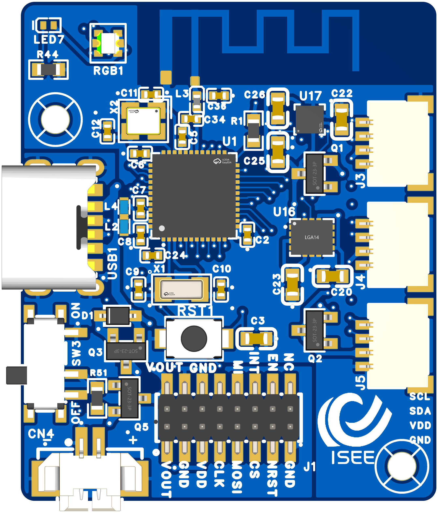
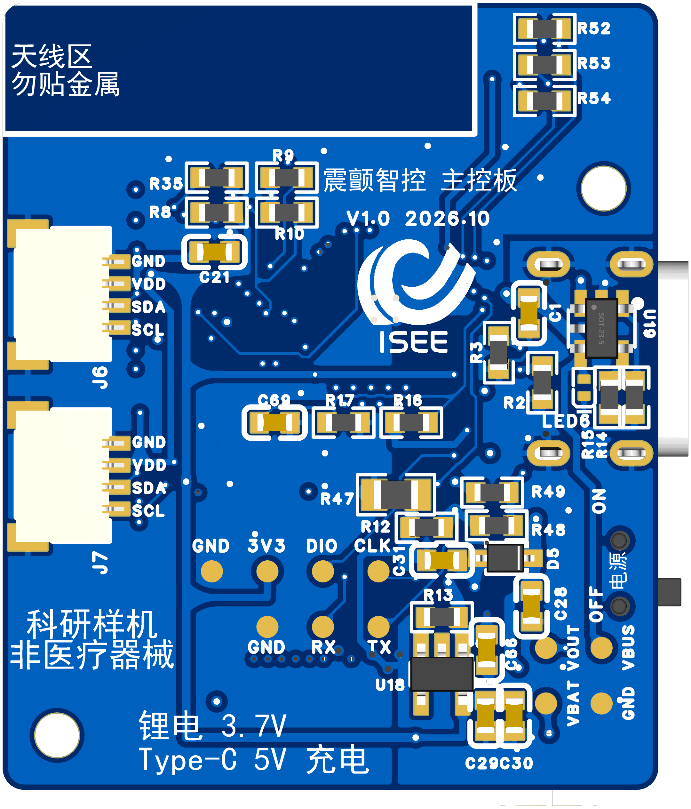
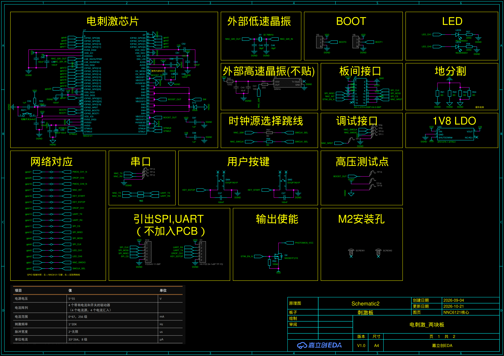
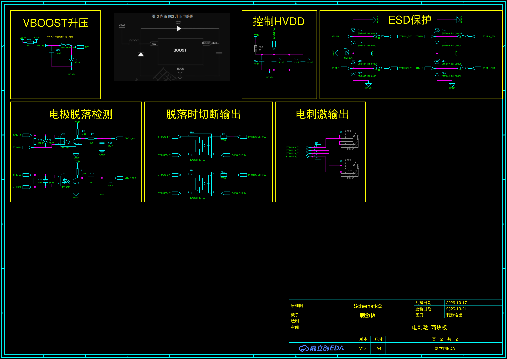
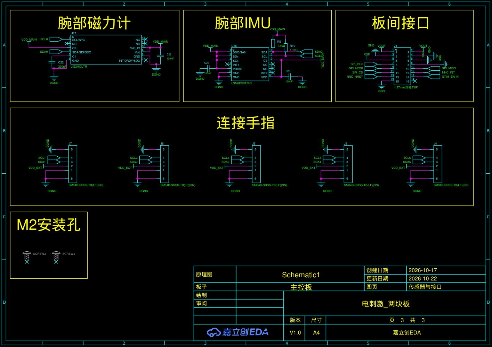
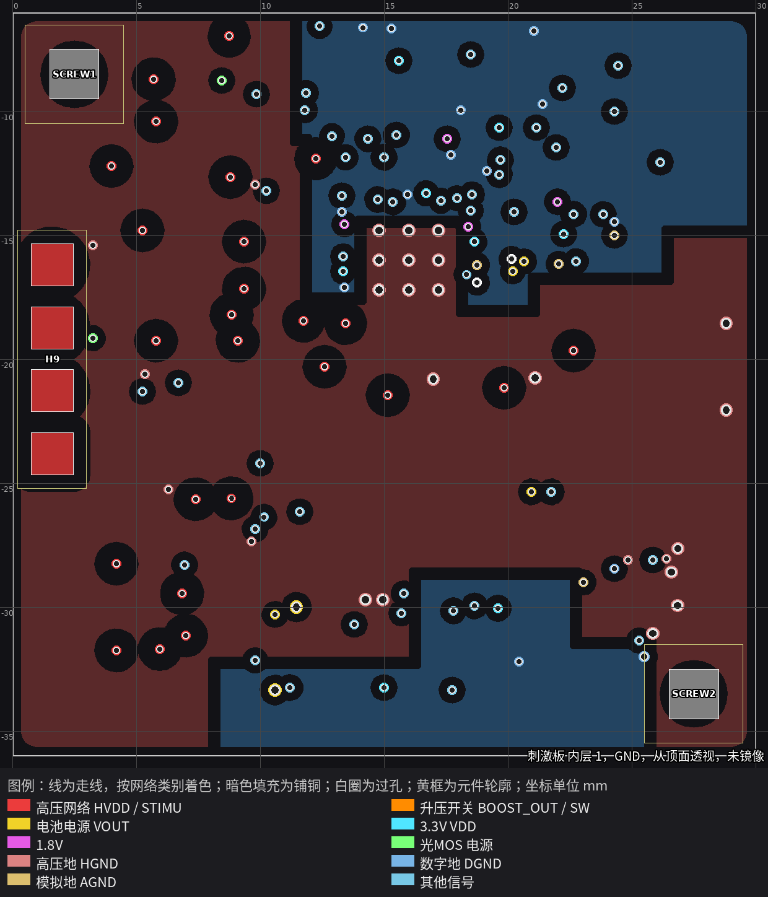
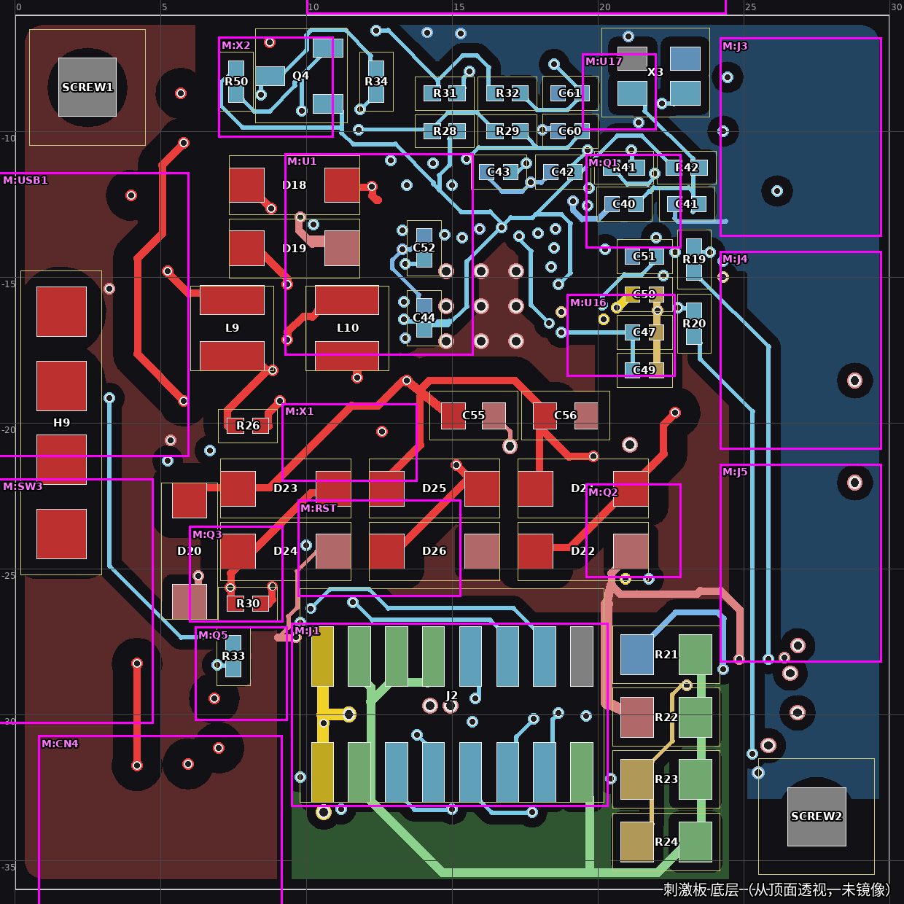

# 震颤评估与干预手套：电路设计

浙江大学 SRTP 项目，潘赟老师课题组。本仓库是手套电路部分的设计文件：一块 nRF52832 主控板和一块 NNC6121 电刺激板，两板叠装。2026 年 10 月两板版原理图与 PCB 完成，DRC 通过，待打样。

Circuit design for a wearable glove that senses Parkinsonian tremor and applies transcutaneous electrical stimulation. Two stacked boards: an nRF52832 main board (4 layers) and an NNC6121 stimulation board (6 layers). Designed in EasyEDA Pro; prototype stage, not a medical device.

> 这是研究原型，不构成任何医疗效果的声明。

| 主控板 nRF52832，四层 | 刺激板 NNC6121，六层 |
|---|---|
|  |  |
|  |  |

## 两块板

| 板 | 主芯片 | 层数 | 主要内容 |
|---|---|---|---|
| 主控板 | nRF52832，BLE | 4 | 8 路 I2C 传感器接口：5 个手指接口和腕部 IMU、磁传感器；RGB 状态灯；USB 充电（MCP73831）与电池电压检测；传感器分组供电开关；2.4G 天线匹配网络；SWD 与串口测试点 |
| 刺激板 | NNC6121 | 6 | 片内升压至 HVDD（≤55V）的双通道经皮电刺激输出；光耦电极脱落检测；光 MOS 通道开关；开始/暂停与急停按键；通道指示灯；1.8V LDO；SWD 与串口测试点 |
| 板间连接 | J1 / J2 | 叠装 | SPI、NNC_INT、NNC_NRST、STIM_EN_N 与电源 |

刺激板叠层：顶层 / GND / SIG1 / SIG2 / GND2 / 底层。高压网络（HVDD、BOOST_OUT、STIMU0–3）单独设 0.6mm 间距规则；数字地、模拟地、高压地分割，在单点汇流；升压区与高压输出区和低压数字区分开布置。

## 原理图

完整 PDF：[主控板](hardware/原理图_主控板.pdf)（电源、nRF52832 核心、传感器与接口，3 页）、[刺激板](hardware/原理图_刺激板.pdf)（NNC6121 核心、刺激输出，2 页）。

刺激板 NNC6121 核心页：芯片、晶振、板间接口、地分割、按键、1V8 LDO 和输出使能。



刺激板输出页：升压、HVDD 控制、ESD、电极脱落检测、脱落时切断输出、电极接口。



主控板传感器与接口页：腕部磁力计与 IMU、板间接口、5 个手指接口。



其余页面的图片在 `hardware/images/`。

## PCB 布线

刺激板六层逐层渲染。线为走线，按网络类别着色，暗色填充为铺铜，白圈为过孔，每张图下方有图例；所有层均从顶面透视，未镜像。

| 顶层 | 内层 1，GND |
|---|---|
|  |  |

| 内层 2，SIG1 | 内层 3，SIG2 |
|---|---|
|  |  |

| 内层 4，GND2 | 底层 |
|---|---|
|  |  |

看图要点：两个 GND 内层按高压地、数字地、模拟地分割，高压地包住左侧 H9 输出和升压区，数字地包住 NNC6121 的数字侧，两者只在一点汇流；高压网络（红）全部走在左侧和顶层，不穿过数字区；SIG1、SIG2 承担跨区的 SPI、按键和脱落检测信号。

与主控板叠装对照（主控板顶层轮廓叠加在刺激板上，用于核对连接器、按键和高压引脚的相对位置）：



局部放大：升压区、NNC6121 周围、低压电源、高压输出，见 `hardware/images/` 中以 `刺激板_2_`、`刺激板_3_` 开头的文件。

## 设计流程

- 工具：嘉立创EDA 专业版（EasyEDA Pro）。
- AI 辅助：通过嘉立创EDA 的脚本接口导出图元，用 Python 脚本做高压规则感知的布线、铺铜连通性检查和器件放置检查；叠层、设计规则、器件选型、原理图修改、最终 DRC 和人工复核由本人完成。
- 文档：引脚表、灯光与按键逻辑、刺激板测试方案见 `docs/`。

## 目录

```
hardware/
  电刺激_两块板_2026-10-19.epro   嘉立创EDA 工程，含主控板与刺激板
  原理图_主控板.pdf、原理图_刺激板.pdf
  主控板_交互式BOM.html           主控板交互式 BOM
  主控板丝印方案.html
  images/                         两板 3D 渲染、原理图各页图片、刺激板各层渲染
docs/
  主控引脚.md                     nRF52832 引脚分配
  电刺激引脚.md                   NNC6121 引脚分配
  灯光逻辑与引脚配置.md           指示灯、按键与状态定义
  测试/                           NNC6121 模组性能验证方案与负载断开测试记录
history/
  2026-05_单板版/                 第一版，电刺激与主控在一块板上
  课题组早期参考设计/             课题组此前的刺激模块、手指板与手腕板，非本人设计
```

nRF52832 与 NNC6121 的数据手册不随仓库分发，请向 Nordic 和厂商获取。

## 版本

- 2026-05：单板版，电刺激与主控同板。
- 2026-10：两板版，主控板 4 层，刺激板 6 层，叠装；原理图与 PCB 完成，待打样。
