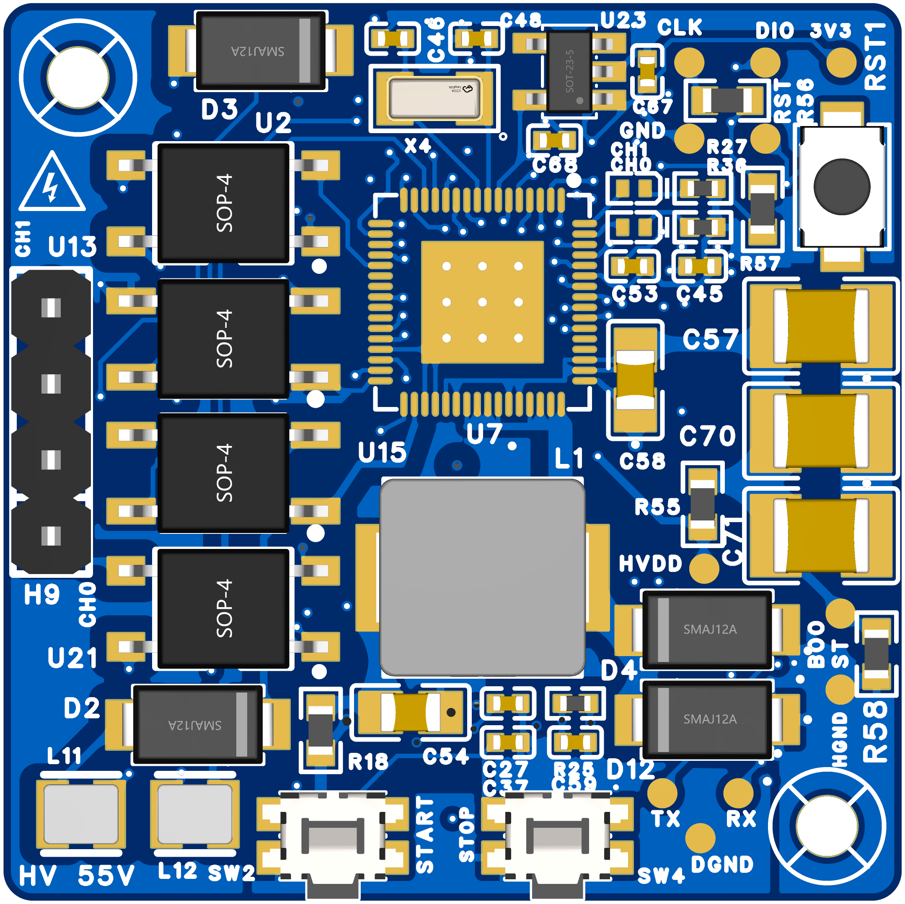
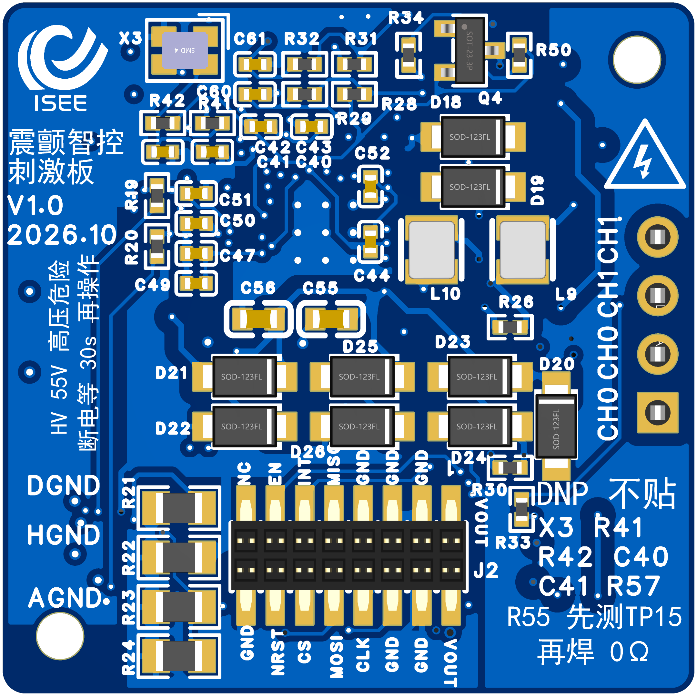
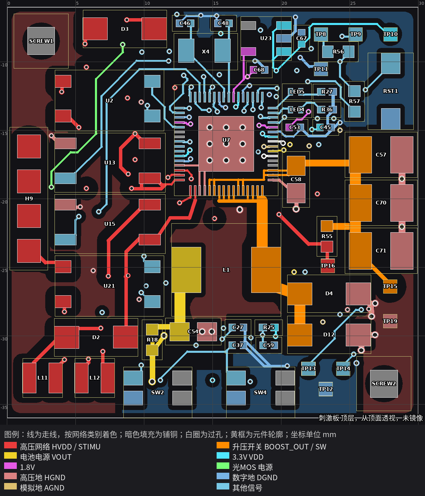
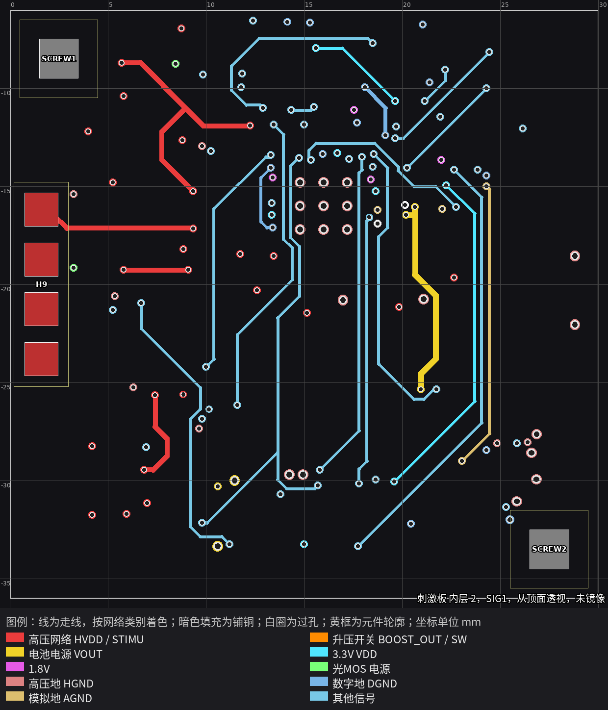
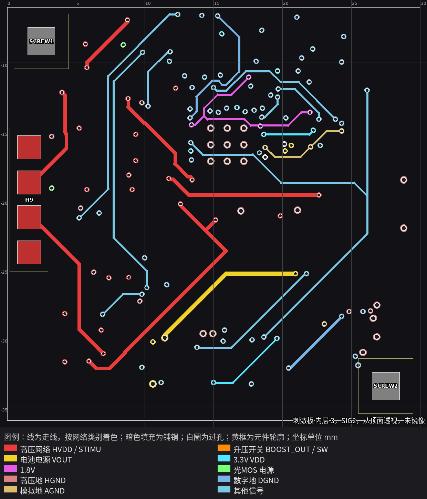
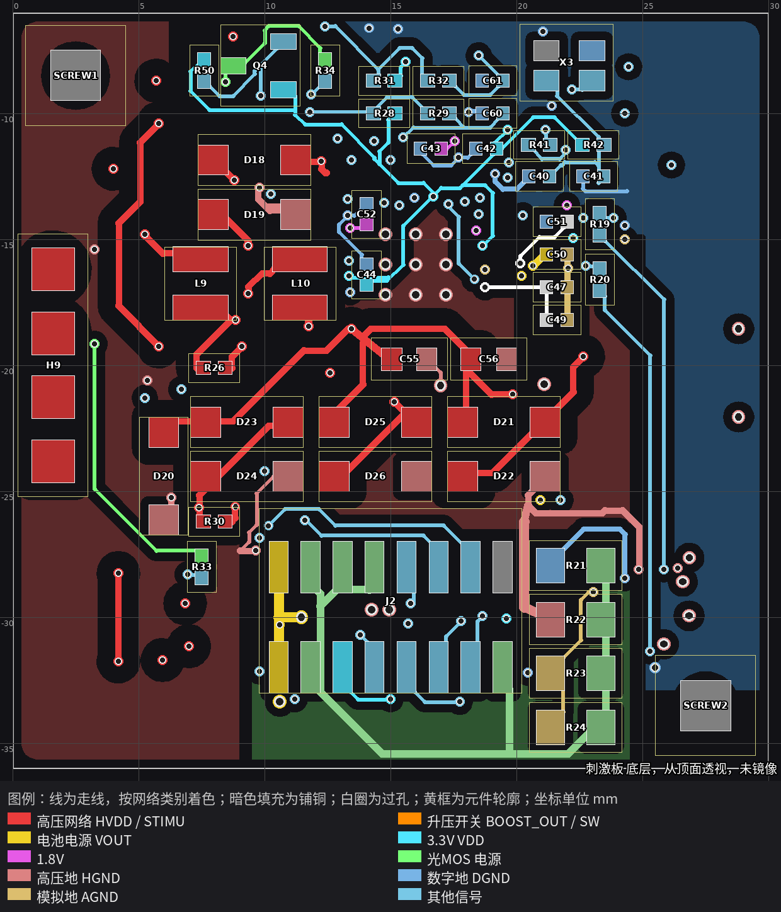

# Tremor Assessment and Intervention Glove: Circuit Design

English | [中文](README_CN.md)

Zhejiang University SRTP undergraduate research project in Prof. Yun Pan's lab. This repository holds the circuit design of a wearable glove that senses Parkinsonian tremor and applies transcutaneous electrical stimulation: an nRF52832 main board and an NNC6121 stimulation board, stacked. I am the sole designer of both boards. Schematics and PCBs were completed in October 2026 and pass DRC; both boards were fabricated in November 2026 and have not yet been powered up.

> This is a research prototype. Nothing here is a claim of any medical effect.

| Main board, nRF52832, 4 layers | Stimulation board, NNC6121, 6 layers |
|---|---|
|  |  |
|  |  |

## The two boards

| Board | Main chip | Layers | Contents |
|---|---|---|---|
| Main board | nRF52832, BLE | 4 | 8 I2C sensor ports: 5 finger ports plus wrist IMU and magnetometer; RGB status LED; USB charging with MCP73831 and battery voltage sensing; switched power per sensor group; 2.4 GHz antenna matching network; SWD and UART test points |
| Stimulation board | NNC6121 | 6 | Two-channel transcutaneous stimulation output with on-chip boost to HVDD, up to 55 V; optocoupler electrode-off detection; photo-MOS channel switches; start/pause and e-stop keys; channel indicators; 1.8 V LDO; SWD and UART test points |
| Board-to-board | J1 / J2 | stacked | SPI, NNC_INT, NNC_NRST, STIM_EN_N and power |

Stimulation board stack-up: top / GND / SIG1 / SIG2 / GND2 / bottom. The high-voltage nets HVDD, BOOST_OUT and STIMU0 to STIMU3 have their own 0.6 mm clearance rule; digital, analog and high-voltage grounds are split and joined at a single point; the boost area is placed apart from both the high-voltage output area and the low-voltage digital area.

## Schematics

Full PDFs: [main board](hardware/原理图_主控板.pdf) (power, nRF52832 core, sensors and connectors, 3 pages) and [stimulation board](hardware/原理图_刺激板.pdf) (NNC6121 core and stimulation output, 2 pages).

Stimulation board, NNC6121 core page: chip, crystal, board-to-board connector, ground split, keys, 1.8 V LDO and output enable.


Stimulation board, output page: boost, HVDD control, ESD, electrode-off detection, output cut-off on electrode-off, electrode connector.


Main board, sensors and connectors page: wrist magnetometer and IMU, board-to-board connector, 5 finger ports.


Images of the other pages are in `hardware/images/`.

## PCB layout

Layer-by-layer renders of the 6-layer stimulation board. Lines are traces colored by net class, dark fills are copper pours, white circles are vias; each image has a legend. All layers are viewed from the top, not mirrored.

| Top | Inner 1, GND |
|---|---|
|  |  |

| Inner 2, SIG1 | Inner 3, SIG2 |
|---|---|
|  |  |

| Inner 4, GND2 | Bottom |
|---|---|
|  |  |

What to look for: both GND layers are split into high-voltage, digital and analog grounds; the high-voltage ground covers the H9 output and boost area on the left, the digital ground covers the digital side of the NNC6121, and the two meet at a single point. All high-voltage nets, in red, stay on the left side and the top layer and never cross the digital area. SIG1 and SIG2 carry the SPI, key and electrode-off signals between areas.

Stack check: the main board top-layer outline overlaid on the stimulation board, used to check the relative positions of connectors, keys and high-voltage pins.


Close-ups of the boost area, the NNC6121 surroundings, the low-voltage supplies and the high-voltage output are the files starting with `刺激板_2_` and `刺激板_3_` in `hardware/images/`.

## Design process

- Tool: EasyEDA Pro.
- AI-assisted scripting: primitives exported through the EasyEDA scripting API, then Python scripts for high-voltage-rule-aware routing, copper connectivity checks and placement checks. Stack-up, design rules, part selection, schematic changes, final DRC and manual review are my own.
- Documentation: pin tables, indicator and key logic, and the stimulation board test plan are in `docs/`.

## Folders

```
hardware/
  电刺激_两块板_2026-10-19.epro   EasyEDA project with both boards
  原理图_主控板.pdf, 原理图_刺激板.pdf   schematics
  主控板_交互式BOM.html, 刺激板_交互式BOM.html   interactive BOMs
  images/                         3D renders, schematic pages, stimulation board layer renders
docs/
  主控引脚.md                     nRF52832 pin assignment
  电刺激引脚.md                   NNC6121 pin assignment
  灯光逻辑与引脚配置.md           indicators, keys and state definitions
  测试/                           NNC6121 module verification plan and load-disconnect test record
history/
  2026-05_单板版/                 first version, stimulation and control on one board
  课题组早期参考设计/             earlier stimulation, finger and wrist boards from the lab, not my design
```

The nRF52832 and NNC6121 datasheets are not redistributed here; get them from Nordic and the chip vendor.

## History

- 2026-05: single-board version, stimulation and control on one board.
- 2026-10: two-board version, 4-layer main board and 6-layer stimulation board, stacked; schematics and PCBs complete.
- 2026-11: both boards of the two-board version fabricated, not yet powered up.
